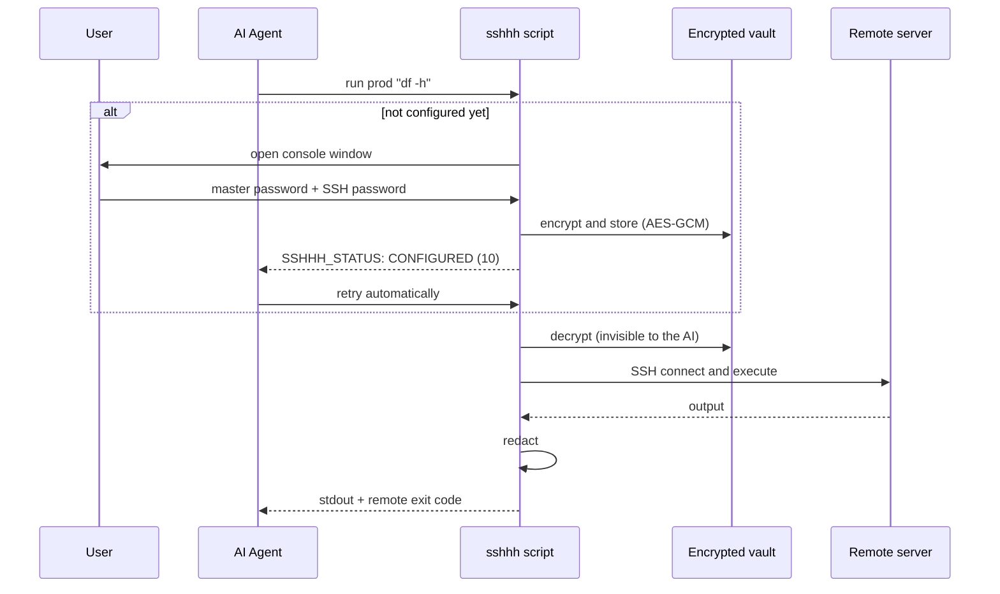

# sshhh

> Give your AI agent SSH access — **without ever putting the password into its context**.

[中文文档](README.md) · [](https://github.com/Hayuuka/sshhh/releases) [](LICENSE)  

---

## Who this is for

- You use **Claude Code / Cursor / Windsurf / Cline / WorkBuddy** and want it to deploy to your server — without putting the SSH password into `.env` or a project config
- You want the agent to help debug production: read logs, check disk, restart a service
- Your security policy says production credentials must never reach a third-party AI service
- You use several AI tools and refuse to configure the same password over and over
- You want the agent restricted to read-only commands — no `rm -rf`, no `shutdown`
- You want to grant temporary server access and still be able to audit what was run

## The problem

To let an agent connect to a server, the usual path is to put the password in a
config file, an environment variable, or paste it straight into the chat.

**Once you do that, the password is in the model's context.** It shows up in the
conversation transcript, the request logs, and possibly the model's memory.

sshhh takes a different route: **the password goes through the script, never
through the AI.**

You type it once in a separate console window. The script encrypts it into a
local vault. When the agent calls `run prod "df -h"`, the script decrypts,
connects, and executes. The agent never sees the plaintext — and never needs to.

## Compared to just giving the AI the password

| | Password in the prompt | With sshhh |
|---|---|---|
| Password enters the conversation context | Yes | **No** |
| Password visible in process list / shell history | Maybe | **No** |
| Remote command echoes the password | Lands in context as-is | **Replaced with `[REDACTED]`** |
| Reconfigure for every new agent | Yes | **No — one shared vault** |
| Restrict which commands the agent may run | No | **Allow / deny rules** |
| Audit who connected and what ran | No | **Audit log** |
| Pollutes system Python | Depends | **No — isolated venv** |

## Features

### 1. The password never enters the AI context

Typing happens in a separate console window, with `getpass` suppressing echo.
After the window closes, the password exists only as ciphertext on disk. No call
the agent makes can read it — not the status lines, not the command output, not
the audit log.

### 2. Configure once, share across every agent

Configuration lives at `~/.sshhh/`, **independent of where the skill is installed**.

Install this skill in Claude Code, Cursor, and WorkBuddy, and all three read the
same vault. They don't overwrite each other, and you never re-enter the password.
Ten copies still means one configuration.

### 3. Zero-config first run

No `init` step, no hand-written config file.

On the first call the script notices the vault is missing, opens a console
window, and asks for the master password plus the first server. When the window
closes, the agent receives a "configured" status and retries automatically.
From the user's side it just looks like the AI paused for a moment.

### 4. A status-code protocol — the AI knows what to do

When the script can't run the command, it returns a reserved exit code plus a
status line on stderr:

```
SSHHH_STATUS: TIMEOUT
SSHHH_MESSAGE: configuration window timed out
SSHHH_HINT: ask the user to run: python "..." config
```

| Status | Code | What the agent should do |
|---|---|---|
| `CONFIGURED` | 10 | Retry the command |
| `HOST_ADDED` | 14 | Retry the command |
| `CANCELLED` | 11 | Stop; tell the user it was cancelled |
| `TIMEOUT` | 12 | Relay the command from `SSHHH_HINT` to the user |
| `LOCKED` | 13 | Suggest `unlock` |
| `NO_RUNTIME` | 20 | Follow the hint to fix the runtime |

No guessing, no trial and error.

### 5. No pollution of system Python

First run creates an isolated venv at `~/.sshhh/venv` and installs dependencies
there. Every later call reuses it. Your system Python stays untouched.

### 6. Restrict what the agent can run

Add allow or deny rules per host (regex, matched against the whole command):

```toml
[hosts.prod.policy]
allow = ['^df -h$', '^systemctl status ', '^docker ps']
deny  = ['^rm -rf', 'shutdown', 'mkfs']
```

In allow-list mode, anything unmatched is refused. An attempt to bypass leaves a
trace in the audit log.

### 7. Automatic output redaction

If a remote command prints the password — a stray `echo $PASS`, a `cat` of some
config file — it is replaced with `[REDACTED]` before reaching the agent.

### 8. Audit log

Every connection appends a JSONL record: timestamp, host, command, exit code,
duration. Commands are redacted before being written, so the log never contains
a password.

```bash
python scripts/sshhh.py audit -n 20
```

### 9. Host key TOFU

The host key is recorded on first connect and verified strictly afterwards. If
the target machine is swapped out, you get a clear error instead of a silent
connection elsewhere.

## Quick start

### 1. Install

**Option A — download the release** (simplest)

Grab `sshhh-skill-vX.Y.Z.zip` from [Releases](https://github.com/Hayuuka/sshhh/releases/latest)
and unzip it into a skills directory:

- User level (all projects): `~/.workbuddy/skills/sshhh/`
- Project level (shared with the team): `<project>/.workbuddy/skills/sshhh/`

**Option B — git clone**

```bash
git clone https://github.com/Hayuuka/sshhh.git ~/.workbuddy/skills/sshhh
```

### 2. Use it

Ask the AI "connect to prod and check disk usage", or run it yourself:

```bash
python scripts/sshhh.py run prod "df -h"
```

The first call opens the configuration window. Once you're done, it connects.

If the window keeps closing the moment it opens (some AI tools reap leftover
processes when a command ends), use this instead — everything happens in your
current terminal, no new window, nothing to reap:

```bash
python scripts/sshhh.py config --here
```

You only do this once; every later call connects directly, no window involved.

## Where your data lives

Everything is under `~/.sshhh/` — **not inside the skill directory**, so
upgrading or reinstalling the skill never touches your configuration.

| Path | Contents |
|---|---|
| `~/.sshhh/vault.enc` | Encrypted passwords (AES-GCM + scrypt). Useless without the master password |
| `~/.sshhh/hosts.toml` | Host list, port, user, policy rules. **No password field** |
| `~/.sshhh/known_hosts` | Host key fingerprints (TOFU) |
| `~/.sshhh/audit.log` | JSONL audit trail, redacted |
| `~/.sshhh/console.log` | Diagnostics for the config window — flow and exceptions only, never your input |
| `~/.sshhh/venv/` | Isolated runtime, ~35 MB, created once |
| `~/.sshhh/.lock` | Cross-process file lock |

On Windows that is `C:\Users\<you>\.sshhh\`. The master password itself is kept
in the OS credential store — Windows Credential Locker, macOS Keychain, or
Secret Service on Linux.

To move to another machine, copy the whole `~/.sshhh/` directory; the master
password stays the same.

## How it works



## Commands

| Command | Purpose |
|---|---|
| `run <host> <command>` | Execute remotely; exit code passed through |
| `list` | List configured hosts |
| `test <host>` | Connectivity check |
| `put` / `get` | Upload / download files |
| `status` | Show data directory, vault, host list |
| `audit [-n N]` | Show recent calls |
| `config` | Open the configuration window manually |
| `setpass <host>` | Change one host's password |
| `unlock` | Re-enter the master password |
| `setup` | Install the runtime only |
| `migrate <old-dir>` | Migrate config from the older `sshx` project |

Common flags:

```bash
python scripts/sshhh.py run prod --sudo "systemctl restart nginx"
python scripts/sshhh.py run prod --timeout 600 "make build"
python scripts/sshhh.py run prod -- tail -n 100 /var/log/nginx/error.log
```

## Security model

**What it protects against**

- The AI casually reading a config file and finding the password
- The password entering the conversation context, logs, or shell history
- The password showing up in the process list (`ps` / Task Manager)
- The remote host echoing the password back
- Error messages leaking credentials on auth failure
- Multiple agents overwriting each other's configuration

**What it does not protect against** (stated plainly)

A program that already has your OS account privileges can call this project's
Python API and decrypt the vault. That is an operating-system boundary; no local
tool can cross it.

To be airtight you would keep the master password in your head and type it every
time — but then the agent can't run unattended.

The real improvement is this: **for the AI to steal the password, it has to
actively write code against internal APIs** rather than just read a file. That
behaviour leaves an audit trail, and is far easier for you to notice.

## FAQ

**The config window closes by itself right after opening.**

Some hosts put every command in a job object and reap leftover processes when the
command ends — the window gets killed along with it. sshhh handles this in two
layers: the window is launched by a separate intermediate process, and after 25
seconds the CLI hands the window off and exits normally so it isn't tied to the
command's lifetime.

If the window still gets reaped, sshhh remembers that and stops trying, telling
the user to run this in their own terminal instead:

```bash
python scripts/sshhh.py config --here
```

Every window start and exception is logged to `~/.sshhh/console.log`.

**I forgot the master password.**

The vault is unrecoverable — that's what encryption means. Delete `~/.sshhh/`
and reconfigure; the cost is re-entering your server passwords.

**PyPI is blocked on my network.**

```bash
set PIP_INDEX_URL=https://pypi.tuna.tsinghua.edu.cn/simple
python scripts/sshhh.py setup
```

Or any other mirror you can reach.

**I want several machines to share one password.**

```toml
[hosts.db1]
password = "@vault:shared"
[hosts.db2]
password = "@vault:shared"
```

**How does sudo work?**

Set `sudo = true` on the host, or pass `--sudo`. The password goes to `sudo -S`
over stdin — never on the command line.

**Does `python` have to exist?**

Python 3.9+ is required. Note that if the `python` command doesn't exist at all,
the script never starts and cannot report anything — you'll need to install
Python yourself first. If Python exists but is older than 3.9, the script will
tell you to upgrade.

## Development

```bash
# dependencies
py -3.14 -m venv .venv
.venv/Scripts/python.exe -m pip install paramiko cryptography keyring

# tests (93 assertions)
.venv/Scripts/python.exe tests/test_flow.py   # main flow and status codes
.venv/Scripts/python.exe tests/test_lock.py   # cross-process locking
py -3.14 tests/test_docs.py                   # docs/code consistency
```

The tests spin up a real local SSH server — no mocks, no network needed.

## License

[MIT](LICENSE)

---

<details>
<summary><b>Keywords</b> — to help people find this</summary>

<br>

ssh for ai agents · ai agent ssh access without password · claude code ssh access ·
cursor ssh server · windsurf ssh · cline ssh · aider ssh · mcp ssh server ·
credential broker for llm · secret injection for ai agents ·
ai coding agent deploy to server · agent safe credentials ·
password never reaches llm · keep secrets out of prompt · ai devops assistant ·
remote server access for ai · ai agent run shell command remotely ·
secure ssh proxy for llm · ai ops automation · ssh key management for agents ·
agent credential vault · ai agent password manager

</details>
