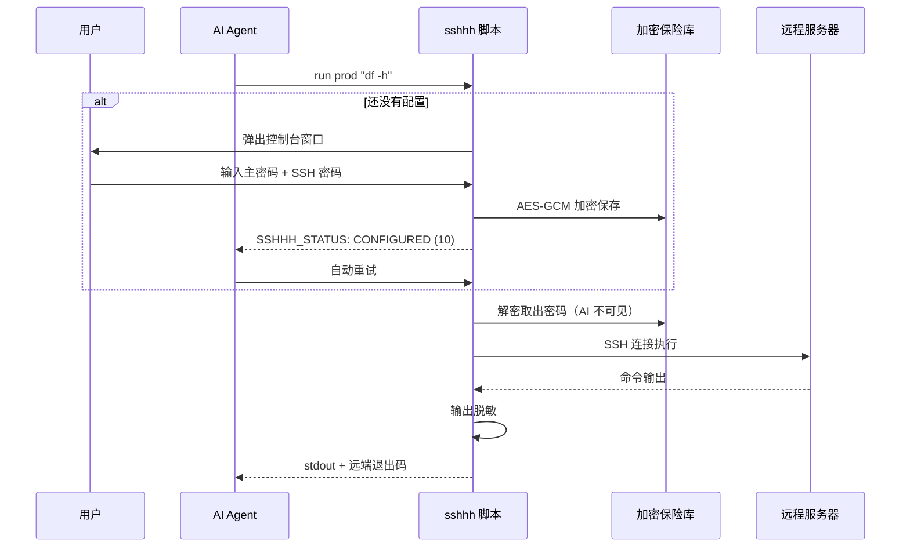

# sshhh      ssh嘘————

薅国内厂商agent的鸡蛋时，想偷懒却不敢直接把ssh用户密码直接丢给ai？
让 AI 能连你的 SSH 服务器，但它**永远看不到密码**。
一次配置，多agent共用

[English](README.en.md) · [](https://github.com/Hayuuka/sshhh/releases)
[](LICENSE)


---

## 适用场景

- 让 **Claude Code / Codex / DSH / Zcode / WorkBuddy** 这类 AI 编程助手
  帮你把代码部署到服务器，又不想把 SSH 密码写进 `.env` 或项目配置
- 让 AI 帮忙排查线上问题：看日志、查磁盘、看服务状态、重启服务
- 公司安全要求「生产环境密码不能进入任何第三方 AI 服务」
- 同时用好几个 AI 工具，不想为每个都配一遍密码
- 想限制 AI 只能跑只读命令，禁止 `rm -rf`、`shutdown`
- 给 AI 临时开一次服务器权限，事后能查它到底跑了什么

## 为什么需要它

现在很多人让 AI agent 帮忙上服务器排障、看日志、重启服务。为了让它能连，
通常只能把密码写进配置文件、环境变量，或者直接贴在对话里。

**一旦这样做，密码就进了 AI 的上下文** —— 它会出现在对话记录、请求日志、
甚至被模型记住。

sshhh 换了个做法：**密码只经过脚本，不经过 AI**。

密码由用户在一个独立的控制台窗口里输入，脚本加密存进本地保险库。
AI 调用时只说「连 prod」，脚本自己去解密、连服务器、执行命令。
AI 全程接触不到明文，也不需要接触。

## 和直接把密码给 AI 的区别

| | 直接把密码给 AI | 用 sshhh |
|---|---|---|
| 密码进入对话上下文 | 是 | **否** |
| 密码出现在进程列表 / 命令历史 | 可能 | **否** |
| 远程回显了密码怎么办 | 原样进入上下文 | **自动替换成 `[REDACTED]`** |
| 换一个 agent 要重新配吗 | 要 | **不用，共用一份** |
| 能限制 agent 跑什么命令吗 | 不能 | **白名单 / 黑名单** |
| 事后能追溯谁连了什么吗 | 不能 | **审计日志** |
| 装 skill 会污染系统 Python 吗 | 视实现而定 | **不会，独立 venv** |

## 特性

### 1. 密码永不进入 AI 上下文

密码在独立的控制台窗口中由用户本人输入，`getpass` 屏蔽回显。
窗口关掉后密码只以密文形式存在于本地，AI 的任何调用都读不到它。

详情：状态行、命令输出、审计日志里都不会出现密码。

### 2. 一次配置，所有 agent 共用

配置固定存放在 `~/.sshhh/`，**与 skill 装在哪里无关**。

你在 Claude Code、Zcode、WorkBuddy 各装一份这个 skill，它们读的是同一份
配置，不会互相覆盖，也不需要重复设置密码。装十份也只配一次。

### 3. 零配置启动

不需要先运行什么 `init`、也不用手写配置文件。

第一次让 AI 连服务器时，脚本发现没有配置，会自动弹出一个控制台窗口，
让用户填主密码和服务器信息，填完窗口关闭，AI 收到「配置完成」状态后自动重试。
用户感知到的就是「AI 卡了一下，然后就连上了」。

### 4. 状态码协议 —— AI 知道该做什么

脚本不执行命令时，会返回明确的保留退出码并在 stderr 打出状态行：

```
SSHHH_STATUS: TIMEOUT
SSHHH_MESSAGE: 配置窗口等待超时
SSHHH_HINT: 请告诉用户在自己的终端里执行：python "..." config
```

| 状态 | 码 | AI 该做什么 |
|---|---|---|
| `CONFIGURED` | 10 | 重试刚才的命令 |
| `HOST_ADDED` | 14 | 重试刚才的命令 |
| `CANCELLED` | 11 | 停止，告诉用户已取消 |
| `TIMEOUT` | 12 | 把 hint 里的命令转告用户 |
| `LOCKED` | 13 | 建议用户 `unlock` |
| `NO_RUNTIME` | 20 | 按 hint 指引处理环境问题 |

不用猜，不用试错。

### 5. 不污染全局 Python

首次运行自动在 `~/.sshhh/venv` 建独立虚拟环境并安装依赖，
之后所有调用都复用它。系统的 Python 环境一动不动。

### 6. 可以限制 AI 能跑什么命令、能碰哪些文件

在主机配置里加规则（正则，命令匹配整条命令，文件规则匹配**远端路径**）：

```toml
[hosts.prod.policy]
allow     = ['^df -h$', '^systemctl status ', '^docker ps']
deny      = ['^rm -rf', 'shutdown', 'mkfs']
allow_put = ['^/tmp/', '^/etc/nginx/conf\.d/']
allow_get = ['^/var/log/']
deny_put  = ['^/etc/']
```

| 字段 | 管什么 | 匹配对象 |
|---|---|---|
| `allow` / `deny` | `run` 执行的命令 | 整条命令 |
| `allow_put` / `deny_put` | `put` 上传 | 远端**目标**路径 |
| `allow_get` / `deny_get` | `get` 下载 | 远端**源**路径 |

规则：

- 白名单非空时，不匹配就拒绝；`deny` 优先于 `allow`。
- **配了 `allow` 命令白名单的主机，文件通道默认关闭**，必须显式写
  `allow_put` / `allow_get` 才能传文件 —— 否则「只允许 `df -h`」的机器
  仍然能被 `get /etc/shadow` 掏空。
- 只配 `deny` 的主机，文件通道照常可用，除非路径命中 `deny_put` / `deny_get`。
- 被拒绝时不会连接主机，退出码为 1，并在审计日志里留一条 `*.denied` 记录。

### 7. 输出自动脱敏

远端命令如果把密码打出来了（比如误执行 `echo $PASS`、`cat` 了某个配置文件），
转给 AI 之前会被替换成 `[REDACTED]`。

### 8. 审计日志

所有触达凭据或远端的动作都会记一条 JSONL。命令、路径写入前已脱敏，日志里不会有密码。

| action | 记什么 |
|---|---|
| `run` / `run.denied` | 执行或拒绝的命令、退出码、耗时 |
| `transfer.put` / `transfer.get` / `transfer.denied` | 传输方向、本地与远端路径、结果 |
| `test` | 探测了哪台机器、结果如何 |
| `setpass` | 哪台主机的密码被改动（不含密码本身） |
| `unlock` | 解锁事件，含自动解锁失败的尝试 |
| `migrate` | 凭据库迁移的来源与条数 |
| `vault.open` | 每一次成功解密：调用方 pid、命令行、工作目录 |

```bash
python scripts/sshhh.py audit -n 20
```

### 9. 主机指纹 TOFU

首次连接自动记录主机密钥，之后严格校验。目标机被换掉时会明确报错，
不会静默连到别处。

## 快速开始

### 1. 安装

**方式一：下载发布包**（最简单）

从 [Releases](https://github.com/Hayuuka/sshhh/releases/latest) 下载 `sshhh-skill-vX.Y.Z.zip`，
解压到 skills 目录：

- 用户级（所有项目可用）：`~/.workbuddy/skills/sshhh/`
- 项目级（团队共享）：`<项目>/.workbuddy/skills/sshhh/`

**方式二：git clone**

```bash
git clone https://github.com/Hayuuka/sshhh.git ~/.workbuddy/skills/sshhh
```

### 2. 用起来

对 AI 说「连一下 prod 看看磁盘」，或者在终端里直接跑：

```bash
python scripts/sshhh.py run prod "df -h"
```

第一次会弹出配置窗口，填完就通了。窗口是独立进程，AI 的命令结束或超时
都不会把它关掉，可以慢慢填。

万一窗口被关掉了，改用下面这条 —— 全程在当前终端里完成，不弹新窗口：

```bash
python scripts/sshhh.py config --here
```

配一次就够，之后所有调用都直接连，不再涉及窗口。

## 数据存在哪里

**不在 skill 目录里**，全部放在用户主目录下的 `~/.sshhh/`。
这样升级、重装、或者删掉 skill 再装一次，配置都不会丢。

| 路径 | 内容 |
|---|---|
| `~/.sshhh/vault.enc` | 加密后的密码（AES-GCM + scrypt）。没有主密码打不开，**头部也不含条目名** |
| `~/.sshhh/hosts.toml` | 主机、端口、用户名、命令策略。**没有 password 字段** |
| `~/.sshhh/known_hosts` | 主机指纹（TOFU） |
| `~/.sshhh/audit.log` | JSONL 审计记录，写入前已脱敏 |
| `~/.sshhh/console.log` | 配置窗口的诊断日志，只记流程和异常，不含任何输入 |
| `~/.sshhh/venv/` | 独立运行时，约 35 MB，只建一次 |
| `~/.sshhh/.lock` | 跨进程文件锁 |

Windows 上是 `C:\Users\<你的用户名>\.sshhh\`。

主密码本身不写在任何文件里 —— 它保存在操作系统凭据库：
Windows 凭据管理器 / macOS 钥匙串 / Linux Secret Service。
所以拷走 `vault.enc` 也没用，没有主密码解不开。

换电脑时把整个 `~/.sshhh/` 拷过去即可，主密码不变。

## 工作原理



## 命令

| 命令 | 作用 |
|------|------|
| `run <主机> <命令>` | 执行远端命令，退出码透传 |
| `list` | 列出已配置的主机 |
| `test <主机>` | 连通性测试 |
| `put` / `get` | 上传 / 下载文件 |
| `status` | 数据目录、密码库、主机清单 |
| `audit [-n N]` | 查看调用记录 |
| `config` | 手动打开配置窗口 |
| `setpass <主机>` | 修改某台主机的密码 |
| `unlock` | 重新输入主密码 |
| `setup` | 只安装运行环境 |
| `migrate <旧目录>` | 从旧版 sshx 项目迁移配置 |

常用参数：

```bash
python scripts/sshhh.py run prod --sudo "systemctl restart nginx"
python scripts/sshhh.py run prod --timeout 600 "make build"
python scripts/sshhh.py run prod -- tail -n 100 /var/log/nginx/error.log
```

## 安全模型

**防的是什么**

- AI 顺手读配置文件拿到密码
- 密码进入对话上下文、日志、命令历史
- 密码出现在进程列表（`ps` / 任务管理器）
- 远端把密码回显出来
- 认证失败时错误信息泄露凭据
- 多个 agent 共用配置时互相覆盖

**防不住什么**（如实说明）

拿到你操作系统账户权限的程序，可以直接调用本项目的 Python 接口解密，
`python -c "from lib import vault; vault.open_vault()"` 一行就够。
这是操作系统级别的边界，任何本地工具都绕不过去。

想真正做到密不透风，只能把主密码留在脑子里、每次手动输入 —— 但那样 AI 就没法自动跑了。

实际收益是：**AI 想偷密码，必须主动写代码去调内部接口**，而不是读一下文件就拿到。
每次成功解密都会往审计日志里写一条 `vault.open`（调用方 pid、命令行、工作目录），
所以这条路**拦不住，但会留痕**，事后能查到，也更容易被你发现。

## 常见问题

**Q：配置窗口刚弹出来就自己关了？**

有些宿主（把每条命令放进作业对象、命令结束就回收残留进程的环境）会把
窗口连带杀掉。现在窗口由**系统资源管理器**拉起，不在脚本的进程树和作业
对象里 —— 脚本退出、AI 的命令超时被打断，窗口都不会关，正在输入的内容
也不会丢。

如果还是没了（比如被你自己关掉），脚本会自动给出不弹窗的方式：

```bash
python scripts/sshhh.py config --here
```

配置窗口的每一次启动和异常都会写进 `~/.sshhh/console.log`，可以直接看。

**Q：主密码忘了怎么办？**

密码库无法恢复（这是加密的意义）。删掉 `~/.sshhh/` 重新配置即可，代价是重新录入服务器密码。

**Q：公司网络连不上 PyPI？**

```bash
set PIP_INDEX_URL=https://pypi.tuna.tsinghua.edu.cn/simple
python scripts/sshhh.py setup
```

**Q：多台机器想共用同一个密码？**

```toml
[hosts.db1]
password = "@vault:shared"
[hosts.db2]
password = "@vault:shared"
```

**Q：sudo 怎么处理？**

主机配置里写 `sudo = true`，或用 `--sudo`。密码通过 stdin 传给 `sudo -S`，
不会出现在命令行里。

**Q：换电脑怎么办？**

拷 `~/.sshhh/` 过去即可，主密码不变。

## 开发

```bash
# 安装依赖
py -3.14 -m venv .venv
.venv/Scripts/python.exe -m pip install paramiko cryptography keyring

# 跑测试（93 项）
.venv/Scripts/python.exe tests/test_flow.py   # 主流程与状态码
.venv/Scripts/python.exe tests/test_lock.py   # 并发锁
py -3.14 tests/test_docs.py                   # 文档与代码一致性
```

测试会起一个本地 SSH 服务端做真实连接，不依赖外网。

## License

[MIT](LICENSE)

---

<details>
<summary><b>关键词 / Keywords</b> —— 帮助需要的人搜到这里</summary>

<br>

**中文**

AI 连服务器不暴露密码 · 让 AI 用 SSH 但不给密码 · AI agent SSH 免密 ·
Claude Code 连服务器 · Cursor 远程部署服务器 · AI 编程助手 部署到服务器 ·
AI 运维 密码安全 · 本地凭据代理 · 密码不进大模型 · AI 自动化运维 ·
MCP SSH 工具 · 给 AI 服务器权限 怎么才安全 · AI 帮我重启服务 ·
把服务器交给 AI 靠谱吗 · AI 排障 看日志 · 生产环境密码 不能给 AI

**English**

ssh for ai agents · ai agent ssh access without password ·
claude code ssh access · cursor ssh server · windsurf ssh · cline ssh · aider ssh ·
mcp ssh server · credential broker for llm · secret injection for ai agents ·
ai coding agent deploy to server · agent safe credentials ·
password never reaches llm · keep secrets out of prompt · ai devops assistant ·
remote server access for ai · ai agent run shell command remotely ·
secure ssh proxy for llm · ai ops automation

</details>
