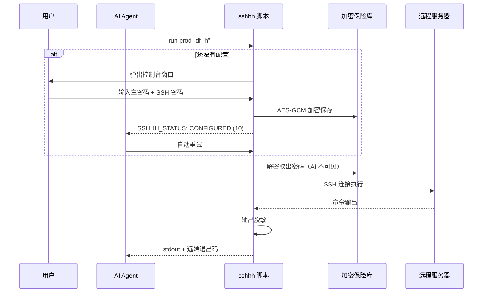

# sshhh

> 让 AI 能连你的 SSH 服务器，但它**永远看不到密码**。

Give your AI agent SSH access without ever putting the password into its context.

[](LICENSE)


---

## 为什么需要它

现在很多人让 AI agent 帮忙上服务器排障、看日志、重启服务。为了让它能连，
通常只能把密码写进配置文件、环境变量，或者直接贴在对话里。

**一旦这样做，密码就进了 AI 的上下文** —— 它会出现在对话记录、请求日志、
甚至被模型记住。

sshhh 换了个做法：**密码只经过脚本，不经过 AI**。

密码由用户在一个独立的控制台窗口里输入，脚本加密存进本地保险库。
AI 调用时只说「连 prod」，脚本自己去解密、连服务器、执行命令。
AI 全程接触不到明文，也不需要接触。

## 和直接把密码给 AI 的区别

| | 直接把密码给 AI | 用 sshhh |
|---|---|---|
| 密码进入对话上下文 | 是 | **否** |
| 密码出现在进程列表 / 命令历史 | 可能 | **否** |
| 远程回显了密码怎么办 | 原样进入上下文 | **自动替换成 `[REDACTED]`** |
| 换一个 agent 要重新配吗 | 要 | **不用，共用一份** |
| 能限制 agent 跑什么命令吗 | 不能 | **白名单 / 黑名单** |
| 事后能追溯谁连了什么吗 | 不能 | **审计日志** |
| 装 skill 会污染系统 Python 吗 | 视实现而定 | **不会，独立 venv** |

## 特性

### 1. 密码永不进入 AI 上下文

密码在独立的控制台窗口中由用户本人输入，`getpass` 屏蔽回显。
窗口关掉后密码只以密文形式存在于本地，AI 的任何调用都读不到它。

详情：状态行、命令输出、审计日志里都不会出现密码。

### 2. 一次配置，所有 agent 共用

配置固定存放在 `~/.sshhh/`，**与 skill 装在哪里无关**。

你在 Claude Code、Cursor、WorkBuddy 各装一份这个 skill，它们读的是同一份
配置，不会互相覆盖，也不需要重复设置密码。装十份也只配一次。

### 3. 零配置启动

不需要先运行什么 `init`、也不用手写配置文件。

第一次让 AI 连服务器时，脚本发现没有配置，会自动弹出一个控制台窗口，
让用户填主密码和服务器信息，填完窗口关闭，AI 收到「配置完成」状态后自动重试。
用户感知到的就是「AI 卡了一下，然后就连上了」。

### 4. 状态码协议 —— AI 知道该做什么

脚本不执行命令时，会返回明确的保留退出码并在 stderr 打出状态行：

```
SSHHH_STATUS: TIMEOUT
SSHHH_MESSAGE: 配置窗口等待超时
SSHHH_HINT: 请告诉用户在自己的终端里执行：python "..." config
```

| 状态 | 码 | AI 该做什么 |
|---|---|---|
| `CONFIGURED` | 10 | 重试刚才的命令 |
| `HOST_ADDED` | 14 | 重试刚才的命令 |
| `CANCELLED` | 11 | 停止，告诉用户已取消 |
| `TIMEOUT` | 12 | 把 hint 里的命令转告用户 |
| `LOCKED` | 13 | 建议用户 `unlock` |
| `NO_RUNTIME` | 20 | 按 hint 指引处理环境问题 |

不用猜，不用试错。

### 5. 不污染全局 Python

首次运行自动在 `~/.sshhh/venv` 建独立虚拟环境并安装依赖，
之后所有调用都复用它。系统的 Python 环境一动不动。

### 6. 可以限制 AI 能跑什么命令

在主机配置里加白名单或黑名单（正则，整条命令匹配）：

```toml
[hosts.prod.policy]
allow = ['^df -h$', '^systemctl status ', '^docker ps']
deny  = ['^rm -rf', 'shutdown', 'mkfs']
```

白名单模式下一旦不匹配就拒绝，AI 想绕过会在审计日志里留痕。

### 7. 输出自动脱敏

远端命令如果把密码打出来了（比如误执行 `echo $PASS`、`cat` 了某个配置文件），
转给 AI 之前会被替换成 `[REDACTED]`。

### 8. 审计日志

每次连接都记一条 JSONL：时间、主机、命令、退出码、耗时。
命令写入前已经过脱敏，日志里不会有密码。

```bash
python scripts/sshhh.py audit -n 20
```

### 9. 主机指纹 TOFU

首次连接自动记录主机密钥，之后严格校验。目标机被换掉时会明确报错，
不会静默连到别处。

## 快速开始

### 1. 安装

放到 skills 目录下（二选一）：

```bash
# 用户级：所有项目可用
git clone <仓库地址> ~/.workbuddy/skills/sshhh

# 项目级：团队共享
git clone <仓库地址> .workbuddy/skills/sshhh
```

也可以下载 release 里的 zip 直接解压到该位置。

### 2. 用起来

对 AI 说「连一下 prod 看看磁盘」，或者在终端里直接跑：

```bash
python scripts/sshhh.py run prod "df -h"
```

第一次会弹出配置窗口，填完就通了。

## 工作原理



## 命令

| 命令 | 作用 |
|------|------|
| `run <主机> <命令>` | 执行远端命令，退出码透传 |
| `list` | 列出已配置的主机 |
| `test <主机>` | 连通性测试 |
| `put` / `get` | 上传 / 下载文件 |
| `status` | 数据目录、密码库、主机清单 |
| `audit [-n N]` | 查看调用记录 |
| `config` | 手动打开配置窗口 |
| `setpass <主机>` | 修改某台主机的密码 |
| `unlock` | 重新输入主密码 |
| `setup` | 只安装运行环境 |
| `migrate <旧目录>` | 从旧版 sshx 项目迁移配置 |

常用参数：

```bash
python scripts/sshhh.py run prod --sudo "systemctl restart nginx"
python scripts/sshhh.py run prod --timeout 600 "make build"
python scripts/sshhh.py run prod -- tail -n 100 /var/log/nginx/error.log
```

## 安全模型

**防的是什么**

- AI 顺手读配置文件拿到密码
- 密码进入对话上下文、日志、命令历史
- 密码出现在进程列表（`ps` / 任务管理器）
- 远端把密码回显出来
- 认证失败时错误信息泄露凭据
- 多个 agent 共用配置时互相覆盖

**防不住什么**（如实说明）

拿到你操作系统账户权限的程序，可以直接调用本项目的 Python 接口解密。
这是操作系统级别的边界，任何本地工具都绕不过去。

想真正做到密不透风，只能把主密码留在脑子里、每次手动输入 —— 但那样 AI 就没法自动跑了。

实际收益是：**AI 想偷密码，必须主动写代码去调内部接口**，而不是读一下文件就拿到。
这种行为会留在审计日志里，也更容易被你发现。

## 常见问题

**Q：主密码忘了怎么办？**

密码库无法恢复（这是加密的意义）。删掉 `~/.sshhh/` 重新配置即可，代价是重新录入服务器密码。

**Q：公司网络连不上 PyPI？**

```bash
set PIP_INDEX_URL=https://pypi.tuna.tsinghua.edu.cn/simple
python scripts/sshhh.py setup
```

**Q：多台机器想共用同一个密码？**

```toml
[hosts.db1]
password = "@vault:shared"
[hosts.db2]
password = "@vault:shared"
```

**Q：sudo 怎么处理？**

主机配置里写 `sudo = true`，或用 `--sudo`。密码通过 stdin 传给 `sudo -S`，
不会出现在命令行里。

**Q：换电脑怎么办？**

拷 `~/.sshhh/` 过去即可，主密码不变。

## 开发

```bash
# 安装依赖
py -3.14 -m venv .venv
.venv/Scripts/python.exe -m pip install paramiko cryptography keyring

# 跑测试（93 项）
.venv/Scripts/python.exe tests/test_flow.py   # 主流程与状态码
.venv/Scripts/python.exe tests/test_lock.py   # 并发锁
py -3.14 tests/test_docs.py                   # 文档与代码一致性
```

测试会起一个本地 SSH 服务端做真实连接，不依赖外网。

## License

[MIT](LICENSE)
